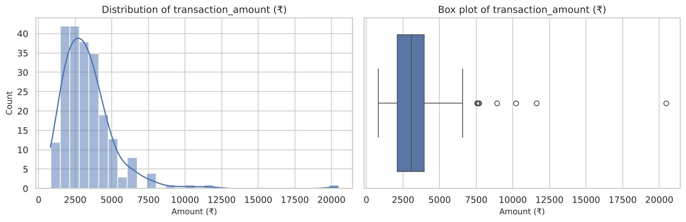
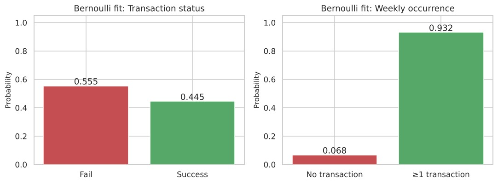
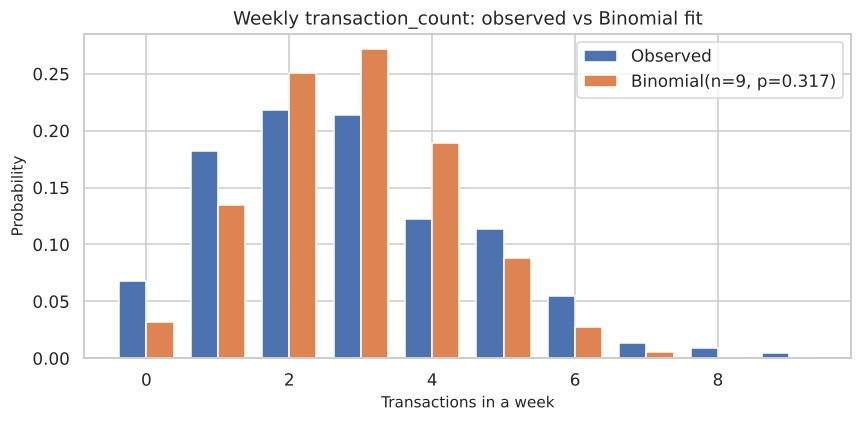
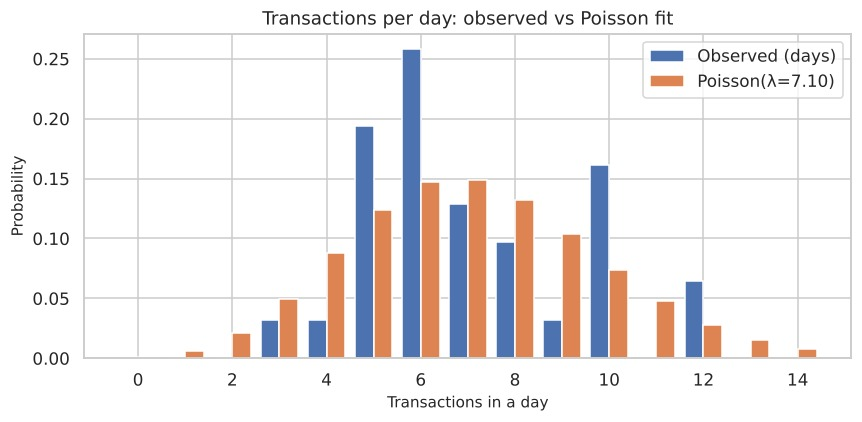
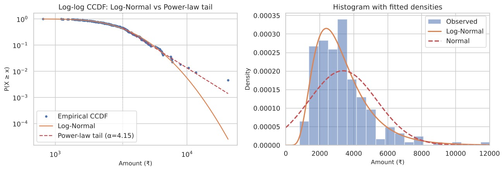
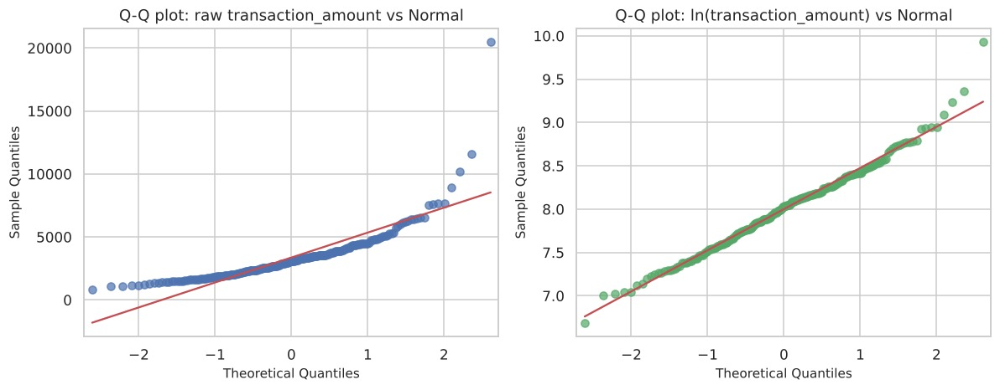
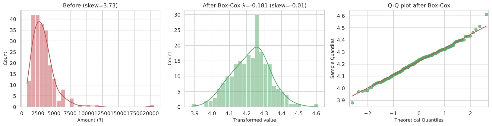
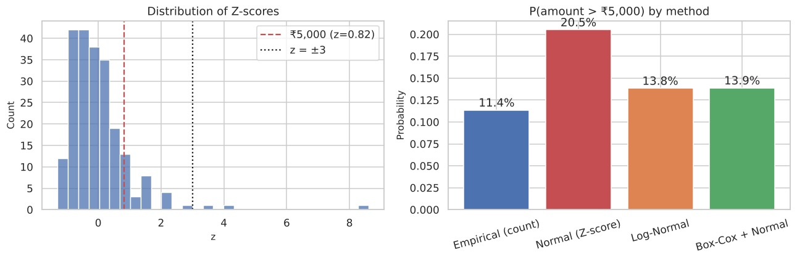
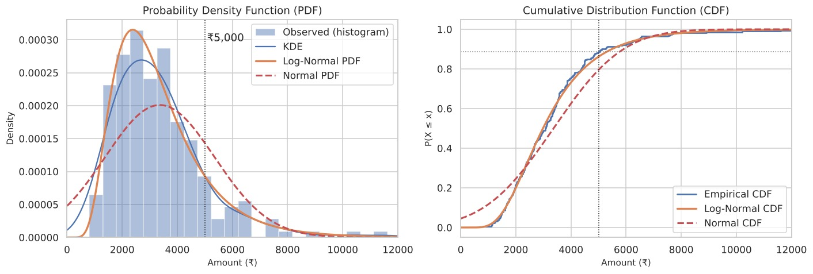

# 📊 Spread Locator – Statistical Distribution Analysis

<p align="center">
  <strong>A Python-based statistical analysis of e-commerce transaction behaviour using probability distributions, hypothesis testing, and data transformation techniques.</strong>
</p>

<p align="center">
  
  
  
  
</p>

---

## 📌 Project Overview

**Spread Locator** is a statistical distribution analysis project designed to understand customer purchasing behaviour using e-commerce transaction data.

The project investigates how transaction amounts and customer activity are distributed, identifies patterns in transaction frequency, evaluates statistical distributions, and derives probability-based business insights.

The analysis uses Python to fit theoretical probability distributions, perform goodness-of-fit tests, examine data normality, apply Box-Cox transformation, and calculate probabilities using different statistical approaches.

### 🎯 Business Objectives

The project addresses the following business questions:

1. Do customer transactions follow known probability distributions?
2. Which statistical distribution best describes transaction amounts?
3. How should highly skewed transaction data be handled?
4. What is the probability of a transaction exceeding ₹5,000?
5. Can transaction frequency be modelled using Bernoulli, Binomial, and Poisson distributions?
6. How can statistical analysis help identify unusual transactions and customer behaviour?

---

## 🗂️ Repository Structure

```text
Spread_Locator_PR3/
│
├── Images/
│   ├── 01_amount_overview.jpg
│   ├── 02_bernoulli.jpg
│   ├── 03_binomial.jpg
│   ├── 04_poisson.jpg
│   ├── 05_lognormal_powerlaw.jpg
│   ├── 06_qq_plots.jpg
│   ├── 07_boxcox.jpg
│   ├── 08_zscore_probability.jpg
│   └── 09_pdf_cdf.jpg
│
├── Spread_Locator_Analysis.ipynb
├── Spread_Locator_Theory_Concepts.pdf
├── spread_locator_dataset.csv
└── README.md
```

---

## 📁 Dataset Description

The dataset contains **220 e-commerce transactions** recorded over 31 days, from 1 January 2023 to 31 January 2023.

| Column | Description |
|---|---|
| `transaction_id` | Unique transaction identifier |
| `customer_id` | Unique customer identifier |
| `transaction_amount` | Transaction value in INR |
| `transaction_date` | Date of transaction |
| `transaction_count` | Transactions by customer in a given week |
| `region` | Customer region (North, South, East, West) |
| `transaction_status` | Transaction outcome (Success / Fail) |

**Dataset observations:**
- Total records: 220
- Time period: 31 days
- Missing values: None
- Duplicate records: None

---

## 🧪 Statistical Analysis & Methodology

The project covers the following statistical concepts and techniques.

| No. | Analysis | Statistical Techniques |
|---|---|---|
| 01 | Amount Overview | Descriptive statistics, distribution, skewness, outlier detection |
| 02 | Bernoulli Distribution | Maximum Likelihood Estimation (MLE), success probability |
| 03 | Binomial Distribution | Parameter estimation, Chi-square goodness-of-fit, exact binomial test |
| 04 | Poisson Distribution | MLE, event frequency, dispersion index |
| 05 | Log-Normal & Power Law | MLE, AIC, BIC, Kolmogorov-Smirnov test |
| 06 | Q-Q Plot Analysis | Normality assessment, Shapiro-Wilk, D'Agostino K² |
| 07 | Box-Cox Transformation | Optimal lambda, skewness reduction, variance comparison |
| 08 | Z-Score Probability | Standardization, outlier detection, probability estimation |
| 09 | PDF & CDF | Probability density, cumulative distribution, percentile analysis |

### Key Statistical Concepts

**Bernoulli Distribution:** Models a single transaction outcome, such as success or failure.

**Binomial Distribution:** Models the number of successful transactions across a fixed number of trials.

**Poisson Distribution:** Models the number of transactions occurring within a fixed time interval.

**Log-Normal Distribution:** Models positively skewed transaction amounts where the logarithm of the values follows an approximately normal distribution.

**Power Law Distribution:** Examines whether extreme transaction amounts follow a heavy-tailed distribution.

**Q-Q Plot:** Compares observed quantiles against theoretical normal quantiles to evaluate normality.

**Box-Cox Transformation:** Reduces skewness and helps make data more suitable for statistical modelling.

**Z-Score:** Measures how far an observation is from the mean in terms of standard deviations.

**PDF & CDF:** Describe probability density and cumulative probability across a distribution.

---

## 📈 Exploratory Data Analysis & Visualizations

The following visualizations are generated as part of the statistical analysis.

### 01. Transaction Amount Overview



### 02. Bernoulli Distribution



### 03. Binomial Distribution



### 04. Poisson Distribution



### 05. Log-Normal & Power Law Distribution



### 06. Q-Q Plot Analysis



### 07. Box-Cox Transformation



### 08. Z-Score & Probability Analysis



### 09. Probability Density Function & Cumulative Distribution Function



---

## 🔍 Key Findings & Statistical Results

The analysis produced the following important findings.

| Statistical Measure | Result |
|---|---:|
| Transaction success probability | 0.445 |
| Transaction failure rate | 55.5% |
| Weekly Binomial probability (p) | 0.317 |
| Weekly transaction count variance | 3.23 |
| Transactions per day (Poisson λ) | ≈ 7.1 |
| Poisson dispersion index | 0.75 |
| Best-fitting transaction distribution | Log-Normal |
| Log-Normal μ | 8.00 |
| Log-Normal σ | 0.47 |
| Log-Normal AIC | 3,821 |
| Log-Normal KS p-value | 0.90 |
| Box-Cox optimal λ | -0.18 |
| Box-Cox transformed skewness | -0.01 |
| Transactions with |Z| > 3 | 3 |

### Important Probability Comparison

**Probability of a transaction exceeding ₹5,000:**

| Method | Estimated Probability |
|---|---:|
| Empirical Probability | 11.4% |
| Log-Normal Model | 13.8% |
| Box-Cox Model | 13.9% |
| Normal Z-Score Model | 20.5% |

The Normal Z-Score approach considerably overestimates the probability of high-value transactions compared with the observed data.

---

## 💡 Business Insights & Recommendations

Based on the statistical findings, the following business recommendations can be derived:

**1. Transaction Amount Modelling**

The Log-Normal distribution provides the best fit for transaction amounts. Businesses should consider using medians and percentiles instead of relying exclusively on averages.

**2. Payment Failure Analysis**

The transaction failure rate is 55.5%. Investigating payment gateway performance, payment methods, and transaction failures could be an important business priority.

**3. Fraud & Anomaly Detection**

Three transactions have absolute Z-scores greater than 3. These transactions should be investigated to determine whether they represent unusual customer behaviour, bulk purchases, or potentially suspicious activity.

**4. Inventory & Operational Planning**

Daily transaction volume is reasonably approximated by a Poisson distribution with λ ≈ 7.1. This can provide a starting point for transaction-volume and operational capacity planning.

**5. Customer Segmentation**

Weekly transaction counts show over-dispersion relative to the fitted Binomial model. Segmenting customers into low-, medium-, and high-frequency groups may provide more meaningful behavioural insights.

**6. Better Probability Estimation**

For highly skewed transaction data, using a suitable distribution such as Log-Normal is preferable to applying normal probability assumptions directly to raw transaction amounts.

---

## 🛠️ Technology Stack

| Technology | Purpose |
|---|---|
| Python | Statistical analysis and programming |
| NumPy | Numerical computations |
| Pandas | Data cleaning and manipulation |
| SciPy | Statistical distributions and hypothesis testing |
| Statsmodels | Statistical modelling and Q-Q plots |
| Matplotlib | Data visualization |
| Seaborn | Statistical visualization |
| Jupyter Notebook | Interactive analysis and documentation |

---

## 🚀 Installation & Execution

### 1. Clone the Repository

```bash
git clone https://github.com/Pratik-Patil-AI/Spread_Locator_PR3.git
```

### 2. Navigate to the Project Directory

```bash
cd Spread_Locator_PR3
```

### 3. Create a Virtual Environment (Recommended)

```bash
python -m venv venv
```

Activate it:

**Windows**
```bash
venv\Scripts\activate
```

**macOS / Linux**
```bash
source venv/bin/activate
```

### 4. Install Dependencies

```bash
pip install numpy pandas scipy statsmodels matplotlib seaborn jupyter
```

### 5. Launch Jupyter Notebook

```bash
jupyter notebook Spread_Locator_Analysis.ipynb
```

Run the notebook cells sequentially to reproduce the analysis and visualizations.

---

## 📚 Project Documentation

The repository includes two main learning resources:

- **[Statistical Analysis Notebook](Spread_Locator_Analysis.ipynb)** – Complete Python implementation, statistical calculations, visualizations, and interpretations.
- **[Theory & Concepts PDF](Spread_Locator_Theory_Concepts.pdf)** – Supporting theoretical explanations of probability distributions and statistical techniques.

- **[Download Dataset](spread_locator_dataset.csv)** – Transaction-level dataset used in the analysis.

---

## ⚠️ Limitations

- The analysis uses only 220 transactions collected over one month.
- Extreme-value and Power Law estimates may be uncertain due to the limited sample size.
- The results describe the supplied dataset and should not automatically be generalized to an entire e-commerce population.
- Statistical model fit does not establish causation.
- Further validation with a larger dataset and a longer observation period would improve reliability.

---

## 🏁 Conclusion

The Spread Locator project demonstrates how probability distributions and statistical techniques can be applied to real-world e-commerce transaction data.

By comparing Bernoulli, Binomial, Poisson, Log-Normal, and Power Law distributions, the analysis identifies patterns in transaction behaviour and evaluates the suitability of different statistical models.

The findings highlight the importance of selecting appropriate distributions, handling skewed data, identifying anomalies, and using probability estimates that accurately represent observed behaviour.

**This project combines statistical theory, Python programming, data visualization, and business interpretation to turn raw transaction data into meaningful analytical insights.**

---

## 👨‍💻 Author

**Mukesh Kote**

GitHub: [@Mukesh-Kote-Official](https://github.com/Mukesh-Kote-Official)

**Project:** Spread Locator – Statistical Distribution Analysis (PR3)

---

<p align="center">
  <strong>⭐ If you find this project useful, consider giving it a star!</strong>
</p>
